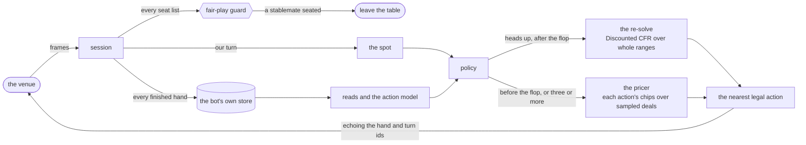
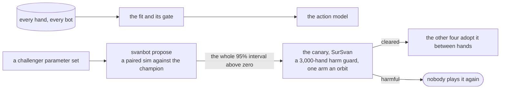
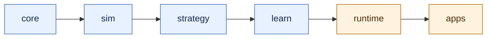

# SvanBot

**A fleet of five no-limit hold'em bots that learns from every hand it plays, and changes how it
plays only on evidence.**

[](https://github.com/SvanLabs/SvanBot/actions/workflows/check.yml)
[](https://github.com/SvanLabs/SvanBot/releases)
[](https://svanlabs.github.io/SvanBot/)

SvanBot plays 6-max no-limit hold'em on [openpoker.ai](https://openpoker.ai), five bots under one
owner, on one CPU-only box. Every decision is made in-process, from
the bot's own store of the hands it has played. v11 is written from scratch in Rust, with the
tooling in TypeScript on Bun, and every line of it is our own: no third-party framework, and no
crate below the runtime layer.

**The site:** <https://svanlabs.github.io/SvanBot/> shows the Arena's latest pinned run and how
the bot works, for a reader who does not want the source.

## Contents

- [Where it stands](#where-it-stands)
- [The Arena headline](#the-arena-headline)
- [How a bot decides](#how-a-bot-decides)
- [How it learns, and how it changes](#how-it-learns-and-how-it-changes)
- [The Arena and the ship bar](#the-arena-and-the-ship-bar)
- [Fair play](#fair-play)
- [The architecture](#the-architecture)
- [Getting started](#getting-started)
- [The gate and CI](#the-gate-and-ci)
- [Running it on the box](#running-it-on-the-box)
- [Documentation](#documentation)
- [Contributing, security, licence](#contributing-security-licence)

## Where it stands

All five bots run v11 on the venue. The work is charted on GitHub as the map
[**V11-00**](https://github.com/SvanLabs/SvanBot/issues/1040) and its tickets, and every change
starts from one. The next release, **v11.1.0**, ships when it clears the ship bar:

1. **The Arena stage.** Both leagues, heads up and 6-max, are played bout by bout and read
   through an anytime-valid 95% confidence sequence. The bar passes once v10.0.2, the last v10
   champion, is wholly beaten in both, and it refuses at once if any row is wholly below zero.
2. **The canary stage.** SurSvan plays the release first. After 20,000 hands its result less the
   fleet's must not be wholly below zero.
3. **The operator's word.**

v10 is kept at the tag `archive/v10/final` and the branch `v10`. It shares no code with v11.

## The Arena headline

The Arena's pinned run, written by `tools/headline.ts` from `fleet/headline.json`. The commit tier
refuses a README that drifts from it.

<!-- headline -->
<!-- Generated by tools/headline.ts from fleet/headline.json. Do not edit by hand: pin a
     run, or change the tool. -->
**Not yet distinguishable from zero**: +128,000 mbb/100 over 100 deals of the Arena across 6 opponents, 95% CI ±214,000.

Played at commit `f8c60d1`, champion `308e7da4b29fd533`, seed 17:

| opponent | mbb/100 | 95% CI | deals |
| --- | ---: | ---: | ---: |
| pricer | +200,000 | ±201,000 | 100 |
| calling station | +54,600 | ±334,000 | 100 |
| nit | +73,400 | ±5,720 | 100 |
| maniac | +221,000 | ±310,000 | 100 |
| switching | +99,700 | ±214,000 | 100 |
| learning | +118,000 | ±222,000 | 100 |

This is the league so far: heads up against the sparring archetypes and the pricer, not the full benchmark. The run above replays every line.
<!-- /headline -->

## How a bot decides



- **The spot** is what a decision knows: our cards, the board, the pot, the legal actions, our
  position, and each opponent's line through the hand, by seat.
- **Ranges** come from the action model: a probability for every move by street, by whether a bet
  faces the player, and by hand strength. A range follows from a line by Bayes' rule. The model
  is fitted on every stored hand and used only once it beats the baseline on hands it has not seen.
- **The re-solve** decides heads up after the flop. It solves the rest of the street over both
  whole ranges by Discounted CFR, with continuation leaves beyond it. The villain's own action
  model is the first leaf, and the exploit budget pins that share of them to it.
- **The pricer** decides everywhere else. It values each legal action in chips over the deals it
  samples. A check or a call is worth our share of the pot. A raise is worth the pot when the
  table folds to it, plus the showdown against whoever calls. Each opponent folds as their model
  folds their hand to a bet, more often the bigger the bet. Raises come in the table's standard
  sizes: an open of 2.5 big blinds, a re-raise of three times the bet, and a third, two thirds
  or the whole of the pot after the flop.
- **Reads** are per opponent and per bot. An opponent's own read tilts the population's model as
  evidence comes in, capped by the exploit budget their adaptivity class earns.
- **The work is an input.** A decision is given its samples, its iterations and a seed, never a
  clock, so the same spot and the same seed give the same action on any machine.

## How it learns, and how it changes



A parameter set is named by its digest, and the fleet plays by one, the champion. A challenger is
first played against it in a paired sim: the same deals from mirrored seats, so the luck of the
cards cancels. Only a challenger whose whole interval is above zero reaches the canary. The
canary's harm guard measures live hands with the luck of its own draws taken out. Every bot keeps
a ledger of what each hand won, with that luck beside it.

## The Arena and the ship bar

The Arena is where a policy is proven. It plays the champion against the pricer, against v10.0.2
(ported fresh and matched to the v10.0.2 binary's actions on 147 recorded spots), and against
five sparring archetypes: the calling station, the nit, the maniac, and the switching and learning
players.

| League | What it is | What it measures |
|---|---|---|
| heads up | each deal twice, from mirrored seats | the re-solve after the flop |
| 6-max | each deal six times, the policy in every seat of a full table | the pricer and the multiway path |

Deals come in bouts of 50, and every run is recorded with the commit, champion and seed it was
played from, so any line on the scoreboard can be played again bit for bit. Two builds compare
row by row over the same bouts with `svanbot paired compare`. `svanbot arena ship` plays both
leagues a heat at a time until the bar is decided, or for at most 48 hours of box CPU.

## Fair play

Fair play is absolute. Two stablemates never share a table: the seat guard sees every seat list
the venue sends, snapshots included, and leaves at the first one that seats a stablemate. A
shared hand is an incident, kept in the store and logged at crit. Each bot's reads are its own,
from its own store, and a store refuses another bot (ADR 0004). Only legal actions reach the
venue, echoing the venue's hand and turn ids, inside the action clock.

## The architecture



Six layers, one crate per layer. A crate depends only on its own layer or a lower one, and the four
layers below `runtime` (in blue) are pure: no network, no file, no store, no clock, no entropy.
`clippy.toml` and `tools/layering.ts` hold that on every commit (ADR 0003).

| Path | What it is |
|---|---|
| `crates/core` | Cards, the hand evaluator, the seeded generator, the rules of a hand, chips, the spot |
| `crates/sim` | Equity by enumeration and by seeded sampling, the table, the sparring archetypes, the v10.0.2 port |
| `crates/strategy` | The action model, reads, the pricer, the re-solve, the policy, parameter sets |
| `crates/learn` | The fit and its gate, priors, drift, adaptivity, the paired sim, the ring, the Arena, the Probe |
| `crates/runtime` | The venue client, the session, the store, the ledger, the fleet's files, the ship bar, updates |
| `crates/apps/svanbot` | The bot, and `arena`, `paired`, `propose`, `download`, `fit`, `release-check` and `dashboard` |
| `crates/apps/updater` | `svanbot-release`: `status`, `install`, `update` and `rollback` |
| `tools/` | The gate, the release packer, the headline, the site check and the agent hooks, in TypeScript on Bun |
| `deploy/` | The installer, the systemd user units and their runbook |
| `site/` | The GitHub Pages site, in plain HTML and CSS |
| `docs/` | The ADRs, the research behind the plan, and the agents' configuration |

Chips are counted in 64 bits throughout (`core::rules::Chips`), and the release is built for the
box's instruction level, x86-64-v2.

## Getting started

```sh
mise run setup                   # the pinned tools, the TypeScript packages, the git hooks: once
mise run commit                  # the fast checks; the pre-commit hook runs them
mise run full                    # adds the tests; run it before a push
```

With a build in `target/dev`:

```sh
svanbot arena 40 7 20 hu.json            # 40 bouts heads up, seed 7, 20 iterations a re-solve
svanbot arena 6-max 40 7 20 ring.json    # the same at a full table
svanbot paired compare base.json next.json   # one build against another, bout by bout
svanbot dashboard                        # the fleet, on http://127.0.0.1:5000
```

Every sim is CPU the fleet shares: run it at low priority (`nice -n 15`).

## The gate and CI

| Tier | Runs | When |
|---|---|---|
| commit | fmt, Biome, the 500-line limit, the secret scan, provenance, the headline, the site check, layering, clippy | every commit, by the pre-commit hook |
| full | the commit tier, then nextest, the doc tests, `tsc`, the tool tests, the page's tests and the disk budget | before every push |
| ci | cargo-deny | on every pull request |

CI runs the commit tier, the test tier and cargo-deny side by side on every pull request into
`main`, and a PR merges only when all three pass. A behaviour change also needs a paired sim that
passes, quoted in the PR. Every commit, issue and PR carries a `Generated-by:` line.

## Running it on the box

The box runs each bot as a systemd user unit, `svanbot@<name>`. A release is a checksummed bundle
CI builds on a `v*` tag. `deploy/install.sh` verifies it, refuses one built above the box's CPU,
and stages it. `svanbot-release update` then swaps `current` between hands, canary first. The
runbook is [`deploy/README.md`](deploy/README.md).

## Documentation

- [`GLOSSARY.md`](GLOSSARY.md): the project's language. Things are named as it names them.
- [`docs/`](docs/README.md): the ADRs, the research notes and the agents' configuration.
- [`AGENTS.md`](AGENTS.md): the brief for people and agents working here, and
  [`llms.txt`](llms.txt) for a model reading the repo cold.
- [`CHANGELOG.md`](CHANGELOG.md): what changed, release by release.

The venue's own documentation, <https://docs.openpoker.ai/llms-full.txt>, comes before anything
written here about the venue.

## Contributing, security, licence

- How a change is made: [`CONTRIBUTING.md`](CONTRIBUTING.md).
- A vulnerability goes to [`SECURITY.md`](SECURITY.md), never to a public issue.
- Dual-licensed under [MIT](LICENSE-MIT) or [Apache-2.0](LICENSE-APACHE), at your option.
